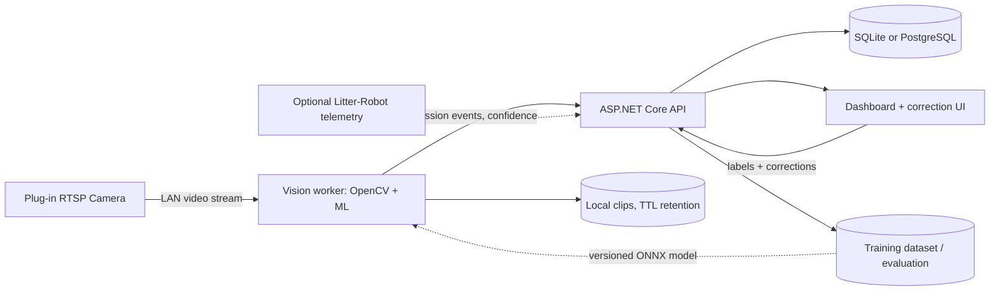

# Architecture — Proposed Local-First System

## High-level components

## Major execution paths

### Online observation path (24/7)

1. Camera provides LAN-accessible RTSP stream; no public camera port forwarding.
2. Edge worker captures frames, maintains short rolling buffer, detects approach/entry.
3. State machine: `IDLE -> APPROACH -> INSIDE -> EXIT_PENDING -> COMPLETE`; handle reentry and multiple cats.
4. Sample identity evidence across multiple frames before/during exit; apply temporal aggregation and reject unknowns.
5. Run a *provisional* waste-type classifier only if behavior/litter evidence is visible; else mark `unknown`.
6. Write visit event to a durable local outbox, then send HTTPS request with stable `visit_id`.
7. ASP.NET Core API idempotently upserts visit and makes it available for review.

### Offline (batch) training path

- A human labels complete visits, including truth source and confidence, in the UI.
- Dataset is reviewed and divided by complete visit/date/camera condition into train/validation/test.
- Models are trained on a development GPU or optionally Azure ML; export ONNX/TensorRT where appropriate.
- CI/evaluation checks thresholds before promoting new version to the edge worker.
- Track model artifact SHA, training data version, and performance metrics.

## Proposed local deployment options

**MVP:** Existing Windows PC runs Python worker and ASP.NET Core API; SQLite DB; optional static dashboard. One box is enough.

**Dedicated:** Jetson/Pi captures and infers locally; C# API can run on a household PC/home server or on the same edge device if supported. Keep the application modular to avoid distributed deployment before needed.

**Optional cloud:** Azure App Service/Container Apps, SQL or PostgreSQL, Blob Storage, Application Insights, Azure ML, optional Service Bus. Only add cloud if remote access or remote training justify cost and operational work.

## Robotics / safety constraint

Mount the camera **outside** the robot in a fixed position. Do not place anything inside the globe, cover the entry curtain sensors, change sensor wiring, impede moving parts, or alter the robot's safety mechanism. Avoid bright illumination that disturbs cats; test IR reflections without modifying robot optics.

## Data flow and reliability

- `visit_id` ULID/UUID generated once at edge; unique DB constraint prevents duplicates.
- Outbox retries exponentially with bounded backoff; local SQLite or file outbox survives temporary API/network failures.
- Capture timestamp in UTC; persist camera ID, model versions, error tags, and uncertainty reasons.
- Apply clip TTL (e.g. 7–14 days while labeling; configurable), encryption and access control if remotely accessible.
- Stream credentials come from secrets or environment variables, never Git.
- Logs contain metadata, not raw frames by default.

## Failure and uncertainty cases

- Cat partially obscured, two cats follow each other, robot starts cleaning, Wi-Fi dropout, stream restart, lighting shift, reflections, incorrect household cat count, no visible elimination, repeat visits.
- A classifier must support `unknown` and `needs_review`; never force high-confidence classification without evidence.
- Sensor fusion is an **optional** enhancement subject to robot capabilities and accessible data.

## Outstanding decision

Exact robot model and physical camera field of view determine whether pee/poop classification is even feasible from the chosen camera alone.
